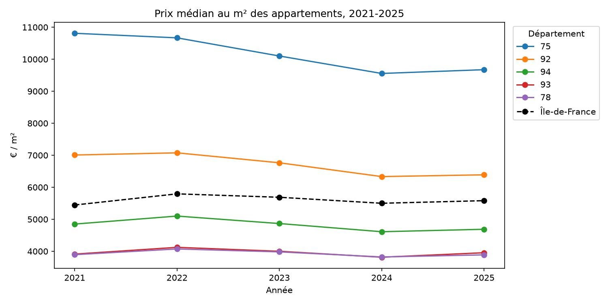
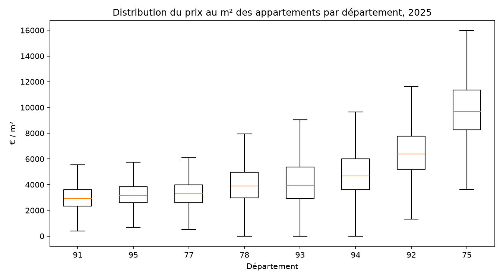

# Marché immobilier en Île-de-France (2021 – 2025)

Analyse exploratoire des ventes de logements en Île-de-France à partir des données publiques **DVF** (Demandes de valeurs foncières).

**Question posée :** comment les prix au m² ont-ils évolué entre 2021 et 2025, et quelles différences existe-t-il entre Paris et le reste de la région ?

## Données

- Source : [DVF géolocalisées](https://www.data.gouv.fr/fr/datasets/demandes-de-valeurs-foncieres-geolocalisees/), data.gouv.fr
- Périmètre : les 8 départements d'Île-de-France (75, 77, 78, 91, 92, 93, 94, 95), de 2021 à 2025
- Volume : 2,4 millions de lignes brutes

## Méthode

1. **Nettoyage**
   - Uniquement les ventes portant sur un seul logement (appartement ou maison) : le prix d'une vente groupée ne peut pas être attribué à un logement.
   - Surfaces d'au moins 9 m² (surface minimale légale).
   - Valeurs aberrantes retirées avec la méthode IQR, par département et type de bien.
   - Résultat : **633 466 ventes** retenues.
2. **Analyse**
   - Prix médian au m² par département, par année et par surface.
   - Comparaison Paris / petite couronne avec un test de Mann-Whitney (les prix ne suivent pas une loi normale).
   - Corrélations de Spearman entre surface, prix et prix au m².

## Principaux résultats

- **Paris :** le prix médian au m² des appartements a baissé de **10,5 %** entre 2021 et 2025 (de 10 811 € à 9 674 €).
- **Volume de ventes :** **−33 %** entre 2021 et 2024, puis reprise de **+18 %** en 2025.
- **Paris vs petite couronne :** les appartements parisiens se vendent **1,8 fois plus cher** au m² (9 674 € contre 5 345 € en 2025, p < 0,001).
- **Effet de composition :** le prix médian régional augmente de 2,5 % alors qu'il baisse ou stagne dans presque chaque département. La part de Paris dans les ventes est passée de 28 % à 32 % : c'est un paradoxe de Simpson.
- **Surface :** les petits logements coûtent plus cher au m² (7 885 € sous 30 m², contre 4 271 € entre 50 et 80 m²).

| Évolution des prix | Distribution des prix en 2025 |
| --- | --- |
|  |  |

## Lancer l'analyse

Prérequis : [uv](https://docs.astral.sh/uv/).

```bash
uv run python analyse_dvf.py
```

`uv run` installe automatiquement les dépendances listées dans `pyproject.toml` (pandas, SciPy, Matplotlib).


## Structure

```
├── analyse_dvf.py   # téléchargement, nettoyage, analyse et graphiques
├── pyproject.toml   # dépendances du projet
├── uv.lock          # versions exactes des dépendances
├── data/            # données DVF (non versionnées)
└── figures/         # graphiques générés
```

## Prochaines étapes

- Pipeline de données sur Databricks, à l'échelle de la France entière
- Modèle de prédiction du prix au m²

## Mes réseaux sociaux

## Mes réseaux sociaux

Bright AMOUZOU · [LinkedIn](https://www.linkedin.com/in/binida-bright-amouzou-449a89217/) · brightamouzou@gmail.com